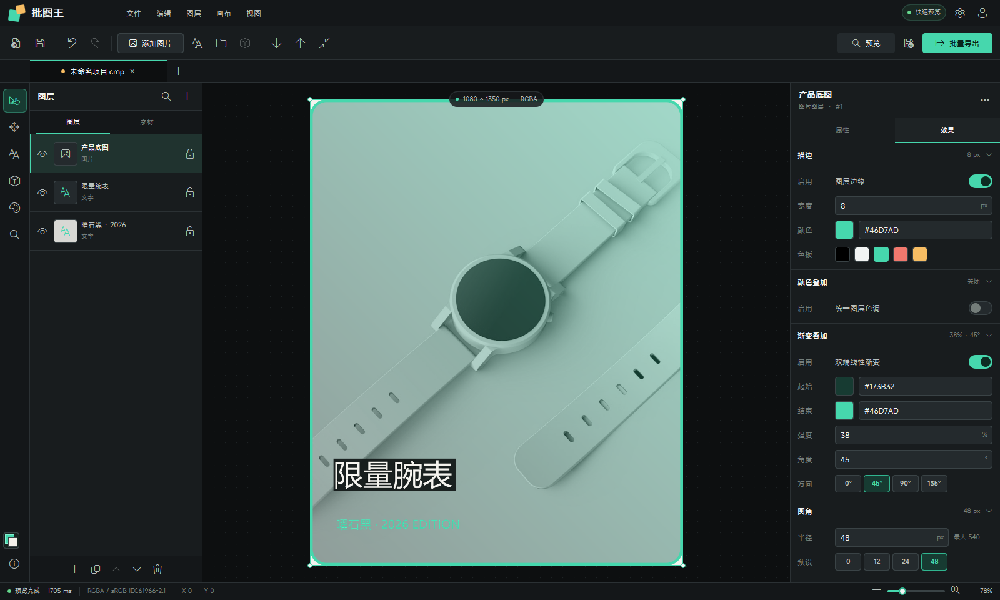

# 批图王 QML 工作台

这是批图王下一代 Qt Quick/QML 入口，已接入真实 `Document`、图层列表、预览渲染、保存加载、撤销重做、单图导出和异步批量导出。画布支持点击选择、拖动、四角缩放、滚轮缩放和基础对齐；右侧属性面板可修改变换、不透明度、混合模式、描边、圆角、颜色叠加和双端线性渐变，并可配置图片单文件/素材文件夹、多行文字候选和整段排版模式。图层面板支持原子复制、前移/后移与删除，复制和层级调整提供键盘快捷键。现有 QWidget 主程序仍由根目录 `main.py` 启动，两个入口互不替换。



```powershell
python app/qml/qml_main.py
```

生成验证截图：

```powershell
python app/qml/qml_main.py --screenshot qml-workbench.png
```

可使用 `--open project.cmp` 直接打开项目，或使用 `--blank` 启动空白文档。`--width` 和 `--height` 可指定截图尺寸，`--show-batch-export` 可打开批量导出抽屉，`--show-effects --demo-effects` 可直接展示真实图层效果，`--select-layer` 可指定启动后选中的图层索引。

画布产品摄影来自 [Unsplash](https://images.unsplash.com/photo-1523275335684-37898b6baf30)，素材仅用于本地界面原型展示。
