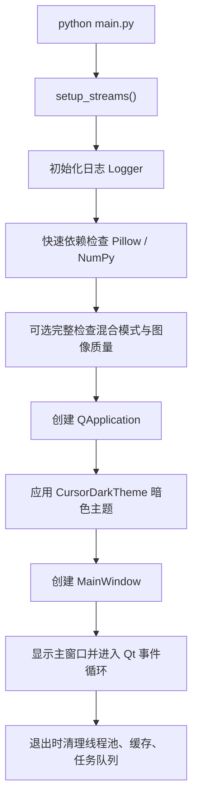
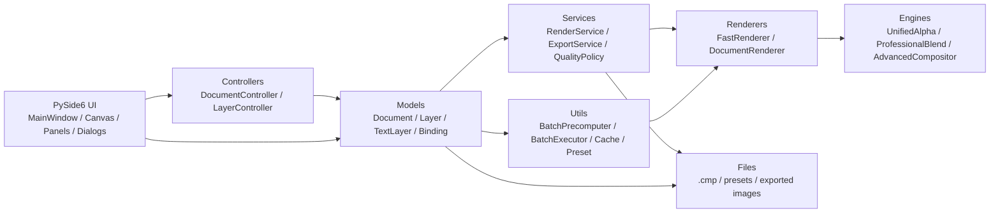
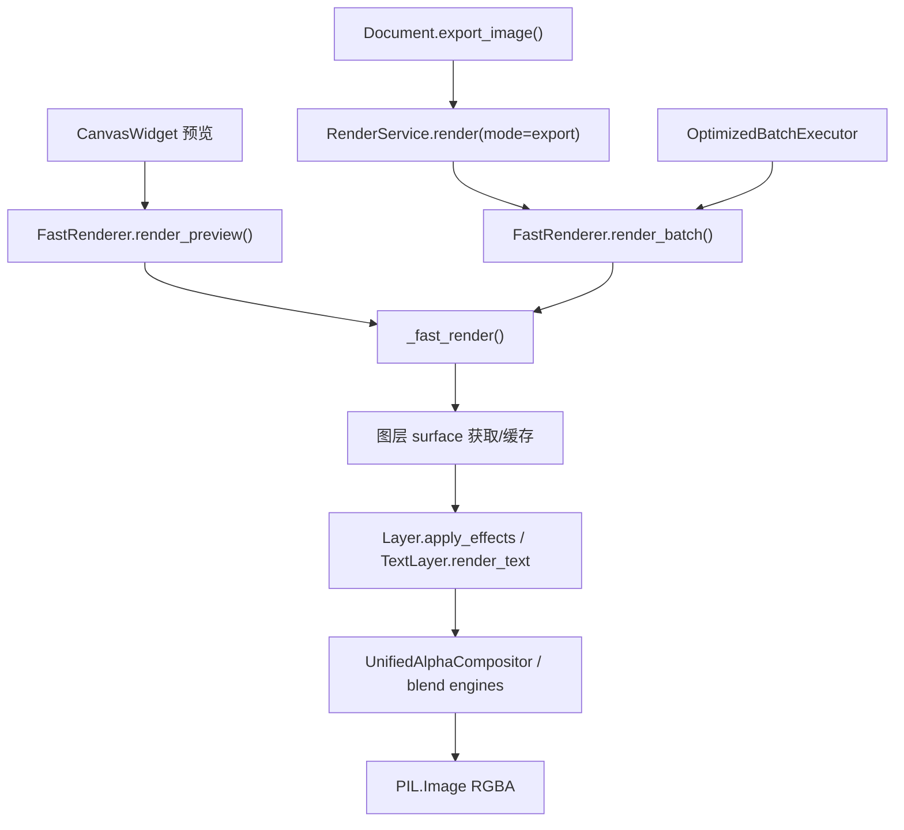
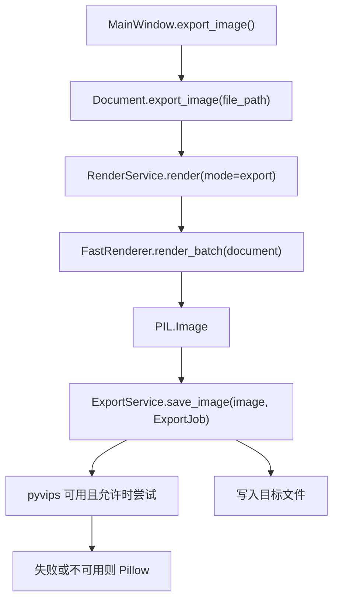
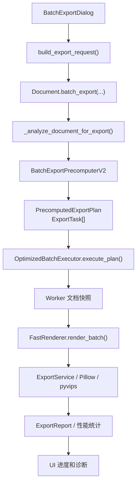

# 批图王 Code Wiki

本文档面向后续维护者和代码代理，目标是把当前仓库的核心结构、运行方式、主要模块职责、关键类与函数、依赖关系和关键数据流集中到一份可查阅的 Markdown Wiki 中。

## 1. 项目定位

`批图王` 是一个 Windows 桌面端图像批量合成与批量导出工具，主要用于把多种图片、文字、异形/矢量图层组合到画布上，并支持单图导出、单文档批量导出、多标签页批量导出和预设复用。

项目当前有新旧实现并存的兼容结构：例如 `Document` 已经拆出历史、序列化、渲染、批导协调器，但仍保留大量旧接口；`app/models/layer.py` 和 `app/models/layer_new.py` 都存在，`app/models/document.py` 里通过 `Layer = NewLayer` 将新图层实现作为主要入口。

核心目标是：预览与导出尽量共用高质量渲染路径，确保所见即所得，同时在批量导出时避免随机图片/文案和绑定组合被缓存误用。

## 2. 技术栈与外部依赖

依赖声明位于根目录 `requirements.txt`。

| 类别 | 依赖 | 用途 |
| --- | --- | --- |
| GUI | `PySide6>=6.9.0` | 主窗口、停靠面板、画布、对话框、信号槽 |
| 图像处理 | `Pillow>=11.1.0` | 图片加载、缩放、裁剪、文字渲染、导出编码 |
| 数值计算 | `numpy>=2.2.0` | Alpha 合成、混合模式、蒙版、像素级处理 |
| 科学计算 | `scipy>=1.15.0` | 部分高级图像算法 |
| 高级图像处理 | `opencv-python>=4.12.0` | 高级合成、质量引擎、相似度/几何检测等 |
| 性能监控 | `psutil>=7.0.0` | 内存保护、线程池和批导资源调度 |
| 打包 | `PyInstaller>=6.14.1` | 单文件 Windows 可执行程序打包 |

可选能力：

- `app/utils/vips_export_engine.py` 会尝试使用 `pyvips` 作为导出后端；不可用时自动回退到 Pillow。
- `app/utils/gpu_renderer.py`、`app/utils/gpu_render_integration.py` 提供 GPU 渲染尝试路径；批量模式默认更偏稳定性。

## 3. 常用命令

建议在项目根目录执行。

```powershell
# 安装依赖
pip install -r requirements.txt

# 开发运行
python main.py

# 自动打包
python build.py

# 使用 spec 文件打包
pyinstaller 批图王.spec
```

当前仓库没有统一测试套件。涉及渲染、导出、序列化、图层属性和批量导出逻辑后，最低验证建议：

1. `python main.py` 可以正常启动。
2. 新建画布，添加普通图层、文字图层、异形图层。
3. 保存 `.cmp` 后重新打开。
4. 单图导出 PNG/JPG。
5. 批量导出多张，确认随机图片/文案不异常重复。
6. 多标签页批量导出。
7. 打包后运行 `dist/批图王.exe`，确认资源和预设可用。

## 4. 目录结构

```text
.
├── main.py                         # 当前主要入口
├── app/application.py              # 旧版/备用入口
├── build.py                        # PyInstaller 自动打包脚本
├── 批图王.spec                     # PyInstaller spec
├── requirements.txt                # 依赖声明
├── presets                         # 初始预设，pickle 二进制内容
├── docs/                           # 项目文档
├── app/
│   ├── main_window.py              # 主窗口与多标签协调中心
│   ├── controllers/                # 文档/图层控制器
│   ├── models/                     # 文档、图层、历史、序列化、绑定等核心模型
│   ├── ui/                         # Qt UI 控件、面板、对话框、画布
│   ├── services/                   # 渲染/导出服务门面与质量策略
│   ├── utils/                      # 渲染、批导、缓存、预设、性能、图像工具
│   ├── engines/                    # 高级合成与混合引擎
│   └── resources/                  # 图标、透明背景等资源
├── build/                          # 构建中间产物，生成目录
├── dist/                           # 打包输出，生成目录
└── __pycache__/                    # Python 缓存，生成目录
```

代码规模较大的热点文件：

| 文件 | 角色 |
| --- | --- |
| `app/models/document.py` | 核心文档模型、兼容旧接口、导出入口 |
| `app/utils/batch_export_precomputer.py` | 批导组合预计算 |
| `app/ui/layer_properties.py` | 图层属性面板 |
| `app/models/layer.py` / `app/models/layer_new.py` | 普通图片图层模型 |
| `app/utils/optimized_batch_executor.py` | 批导执行、并发、写盘、报表 |
| `app/ui/canvas.py` | 画布交互、异步预览、参考线、拖拽 |
| `app/models/binding_manager.py` | 图层绑定与分类匹配 |
| `app/utils/fast_renderer.py` | 预览/导出快速渲染核心 |
| `app/ui/layer_panel.py` | 图层列表、分组、多选、上下文菜单 |
| `app/models/text_layer.py` | 文字图层与文字渲染 |

## 5. 启动流程

主要入口是根目录 `main.py`。



关键点：

- `app.utils.stream_redirector.setup_streams()` 会优先执行，避免控制台流对象或编码异常影响后续导入。
- `main.py` 会尝试加载 `app.utils.core.startup_optimizer`，可用时使用启动任务队列与启动画面；不可用时走普通启动路径。
- 应用固定使用 `CursorDarkTheme`，不跟随系统主题。
- `app/application.py` 也能创建 `QApplication` 和 `MainWindow`，但更像旧入口；维护时优先看 `main.py`。

## 6. 整体架构



架构风格：

- UI 层直接持有文档对象，并通过 Qt 信号响应 `document_changed`、`layer_changed`、`layers_selection_changed` 等变化。
- 控制器层负责把主窗口菜单/按钮动作转成模型操作，降低 `MainWindow` 中新增逻辑的复杂度。
- 模型层以 `Document` 为中心，持有画布、图层列表、导出设置、视图设置、绑定管理器和大小匹配管理器。
- 渲染和导出正在向服务门面集中：`RenderService` 和 `ExportService` 是新代码优先使用的接口。
- 性能敏感路径集中在 `FastRenderer`、`BatchExportPrecomputerV2` 和 `OptimizedBatchExecutor`。

## 7. 核心数据模型

### 7.1 Document

文件：`app/models/document.py`

`Document(QObject)` 是核心文档模型。它包含：

- 画布尺寸：`canvas_width`、`canvas_height`
- 图层列表：`layers`
- 选择状态：`selected_layer_index`、`selected_layer_indices`
- 文件路径：`current_file_path`
- 修改状态：`is_modified`
- 导出设置：`export_settings`
- 视图设置：标尺、参考线、吸附、缩放、偏移
- 历史管理：`DocumentHistory`
- 序列化：`DocumentSerializer`
- 通用渲染：`DocumentRenderer`
- 批导协调：`BatchExportCoordinator`
- 绑定：`LayerBindingManager`
- 大小匹配：`LayerSizeMatchManager`

重要信号：

| 信号 | 用途 |
| --- | --- |
| `document_changed` | 文档内容变化，画布/标题/保存状态等刷新 |
| `layer_changed` | 图层列表变化 |
| `layers_changed` | 图层内容变化 |
| `layer_updated(int)` | 单个图层更新 |
| `layer_selected(int)` | 单图层选择变化 |
| `layers_selection_changed(list)` | 多选变化 |
| `history_changed` | 撤销/重做状态变化 |
| `export_progress_updated(int)` | 批导进度 |
| `file_exported(str)` | 单文件导出完成 |
| `export_stage_updated(str)` | 批导阶段文案 |

关键方法：

| 方法 | 说明 |
| --- | --- |
| `create_new(width, height)` | 初始化新画布 |
| `add_layer(...)` | 新增普通图片图层 |
| `add_text_layer(text_layer)` | 新增文字图层 |
| `add_shaped_layer(shaped_layer)` | 新增异形图层 |
| `remove_layer(index)` | 删除图层 |
| `move_layer_up/down(...)` / `move_layer(...)` | 图层排序 |
| `select_layer(index)` / `select_layers(indices, primary_index)` | 选择状态维护 |
| `save_state(action_name)` | 保存历史快照，当前仍保留旧历史字段兼容 |
| `undo()` / `redo()` | 撤销/重做 |
| `save_document(file_path)` | 以 pickle 保存 `.cmp` |
| `load_document(file_path)` | 加载 `.cmp`，恢复图层/导出/视图/绑定/大小匹配 |
| `render_document()` | 使用 `DocumentRenderer` 渲染，失败时回退 legacy |
| `render_composition(...)` | 旧兼容渲染路径，仍被部分回退逻辑使用 |
| `export_image(file_path)` | 单图导出入口，优先 `RenderService` + `ExportService` |
| `batch_export(...)` | 单文档批导入口，强制走 V2 预计算优化导出 |
| `_analyze_document_for_export()` | 批导前分析绑定、可见层、导出模式 |
| `_cleanup_layers_after_export()` | 批导后清理图层临时状态 |
| `create_layer_from_data(layer_data)` | 反序列化兼容入口 |

注意：

- `Document` 中有 `LegacyLayer` 和大量旧渲染/导出方法。新增功能时不要只改新拆分模块，要确认旧入口是否仍被回退路径调用。
- `.cmp` 是 pickle 二进制格式，不要用文本方式读写。
- 文档加载后会调用 `_clear_layer_temporary_states()`，避免旧文件中的临时图片路径污染当前预览/导出。

### 7.2 普通图片图层 Layer

主要文件：

- `app/models/layer_new.py`：当前主要实现
- `app/models/layer.py`：旧版/兼容实现，仍被部分控制器直接导入

`layer_new.Layer(QObject)` 使用 `LayerPropertyManager` 管理大量属性。

核心属性：

| 属性组 | 代表字段 |
| --- | --- |
| 基础 | `name`、`x`、`y`、`width`、`height`、`visible`、`opacity`、`locked` |
| 图片源 | `image_source`、`is_folder`、`current_image_path`、`use_original_size` |
| 适配裁剪 | `fit_mode`、`crop_direction` |
| 变换 | `rotation`、`flip_horizontal`、`flip_vertical`、`aspect_ratio_locked` |
| 随机变换 | `random_position_enabled`、`random_scale_enabled`、`random_rotation_enabled` |
| 分身 | `clone_enabled`、行列数、间距、镜像、填充模式、自定义尺寸 |
| 效果 | 圆角、描边、混合模式、颜色叠加、渐变叠加 |
| 矢量 | `vector_path_enabled`、路径点、贝塞尔节点、闭合、控制柄模式 |
| 绑定 | `bind_enabled`、`bind_group`、`bind_strategy` |

关键方法：

| 方法 | 说明 |
| --- | --- |
| `get_random_image(force_random=False, restrict_to_bound_files=None)` | 从文件夹随机取图或加载单文件 |
| `get_image()` | 获取当前图层图像，优先使用当前路径和缓存 |
| `_load_and_process_image(image_path)` | 加载源图并进入处理管线 |
| `_process_image(original_image)` | 裁剪、缩放、适配目标尺寸 |
| `_scale_and_crop(image)` | 等比缩放裁剪 |
| `_scale_to_fit(image)` | 等比缩放居中不裁剪 |
| `apply_effects(image)` / `_apply_effects(image)` | 圆角、描边、叠加、矢量等效果 |
| `generate_random_transform_params()` | 生成当前随机变换参数 |
| `reset_random_transforms()` | 清除随机变换状态 |
| `get_effective_position()` / `get_effective_clone_positions()` | 计算考虑随机偏移后的实际位置 |
| `serialize()` / `deserialize(data)` | 图层序列化 |
| `duplicate(parent=None)` | 深拷贝图层 |

图像缩放/旋转会优先使用 `app/utils/rgba_resampler.py` 的预乘 Alpha 处理，减少半透明边缘黑边/白边。

### 7.3 TextLayer

文件：`app/models/text_layer.py`

`TextLayer(QObject)` 负责文字内容、字体、排版、描边、渐变、背景、超采样渲染和随机文案。

核心能力：

- 多行文字候选：`text_lines`
- 当前渲染文案：`current_text`
- 绑定模式：`text_binding_enabled`
- 字体扫描与 `fonts_cache.json`
- 对齐、行距、字距、内边距
- 自动适配文本框：`auto_fit_text_box`
- 横排/竖排：`vertical_layout`
- 描边、背景、线性/径向/角度渐变
- 超采样渲染：`_supersample_enabled`、`_supersample_scale`
- 渲染锁：`_render_lock`，避免预览和批导并发污染临时渲染参数

关键方法：

| 方法 | 说明 |
| --- | --- |
| `get_system_fonts()` | 获取系统字体并使用缓存 |
| `parse_text_input_to_lines(text)` | 根据绑定模式解析文案 |
| `randomize_text()` | 随机选择候选文案 |
| `render_text()` | 文字图层主渲染入口 |
| `_render_text_supersampled()` | 超采样渲染后缩回目标尺寸 |
| `_render_text_internal()` | 常规横排文字渲染 |
| `_render_text_vertical_internal(...)` | 竖排文字渲染 |
| `_update_text_box_size_if_needed()` | 自动调整文本框尺寸 |
| `_normalize_auto_fit_padding(image)` | 自动适配时统一真实像素边距 |
| `serialize()` / `deserialize(data)` | 文本图层保存/恢复 |
| `duplicate(parent=None)` | 复制文字图层 |

维护注意：

- 修改文字字段时必须清理 `_cached_image` 并发出 `text_changed` / `changed`。
- 绑定模式开启时，换行会拆成多个候选文案；关闭时，整体多行文本作为一条文案。

### 7.4 ShapedLayer 与矢量/异形

主要文件：

- `app/models/shaped_layer_new.py`
- `app/models/shaped_layer.py`
- `app/models/layer_properties.py`
- `app/utils/vector_layer_geometry.py`
- `app/utils/vector_layer_effects.py`

异形图层基于普通图层扩展形状遮罩，支持矩形、直角梯形、圆形、五边形、六边形等；新实现更多复用 `LayerPropertyManager` 和普通图层效果管线。

关键组件：

| 组件 | 说明 |
| --- | --- |
| `ShapeType` | 形状类型枚举 |
| `ShapedLayer` | 异形图层模型 |
| `LayerPropertyManager` | 图层属性统一注册、校验、序列化 |
| `CommonLayerOperations` | 复用变换、分身位置等通用操作 |
| `vector_layer_geometry` | 构造圆角矩形、多边形、贝塞尔路径点 |
| `vector_layer_effects` | 矢量路径填充、描边、蒙版和效果 |

关键方法：

| 方法 | 说明 |
| --- | --- |
| `ShapedLayer._apply_effects(image)` | 应用形状遮罩和图层效果 |
| `ShapedLayer.serialize()` / `deserialize()` | 保存/恢复异形参数 |
| `Layer.convert_rect_to_vector_path()` | 将矩形转换成可编辑路径节点 |
| `update_vector_*` 系列 | 编辑矢量节点、锚点、手柄、节点类型 |

### 7.5 LayerGroup 与图层树

文件：

- `app/models/layer_group.py`
- `app/utils/layer_tree.py`

运行时图层列表仍是线性列表，分组通过 `LayerGroup` 节点和子图层的 `parent_group_id` 建立关系。

`layer_tree.py` 提供：

| 函数 | 说明 |
| --- | --- |
| `is_layer_group(node)` | 判断是否为组 |
| `get_parent_group_id(layer)` / `set_parent_group_id(layer, group_id)` | 读写父组 |
| `is_effectively_visible(layer, nodes)` | 同时考虑自身和父组可见性 |
| `is_effectively_locked(layer, nodes)` | 同时考虑自身和父组锁定 |
| `render_layers(nodes)` | 取可渲染的真实图层 |
| `display_entries(nodes)` | 生成图层面板自上而下显示列表 |
| `serialize_layer_tree(...)` | 将线性运行时列表保存成递归组结构 |
| `deserialize_layer_tree(...)` | 将递归组结构恢复为运行时线性列表 |

## 8. 控制器与主窗口

### 8.1 MainWindow

文件：`app/main_window.py`

`MainWindow(QMainWindow)` 是应用层协调中心。

职责：

- 创建菜单、工具栏、状态栏、停靠面板和多标签页。
- 持有 `DocumentManager`、当前 `document`、`DocumentController`、`LayerController`。
- 管理每个文档对应的批量导出窗口和多标签导出窗口，避免跨文档共享窗口状态。
- 处理新建、打开、保存、导出、批导、多标签导出、预设中心等入口。
- 负责标签页标题、窗口标题、运行状态、关闭确认、窗口布局保存恢复。

关键方法：

| 方法 | 说明 |
| --- | --- |
| `setup_ui()` | 创建中央 `QTabWidget` |
| `create_actions()` | 创建菜单/工具栏动作和快捷键 |
| `create_dock_widgets()` | 创建图层面板、属性面板、预设面板等停靠窗口 |
| `connect_signals()` | 连接文档管理器、控制器和 UI 信号 |
| `create_new_tab(document=None)` | 为文档创建标签页 |
| `tab_changed(index)` | 切换活动文档 |
| `batch_export()` | 打开当前文档的非模态批导窗口 |
| `multi_tab_export()` | 打开多标签页批导窗口 |
| `save_as_preset()` | 将当前打开的全部标签页保存为预设 |
| `apply_preset_to_tabs(...)` | 从预设恢复一个或多个文档标签 |

### 8.2 DocumentController

文件：`app/controllers/document_controller.py`

职责：

- 新建文档：弹出 `NewCanvasDialog`，创建 `Document` 并交给 `MainWindow.create_new_tab()`。
- 打开 `.cmp`：创建新 `Document`，调用 `load_document()`。
- 保存/另存为：同步当前标签页视图设置后调用 `Document.save_document()`。
- 通过信号向主窗口报告操作完成和状态消息。

### 8.3 LayerController

文件：`app/controllers/layer_controller.py`

职责：

- 图层新增、删除、移动、复制、粘贴、重命名、全选、对齐。
- 支持序列化剪贴板格式 `layer_serialized_v1`，便于跨文档粘贴。
- 支持图层组复制：复制组头时同步复制子图层。
- 多图层批量更新：`batch_update_layers(...)` 统一保存历史、跳过锁定层、清理缓存并刷新 UI。
- 批量应用样式：`apply_style_to_selected(...)`。

注意：该文件当前导入 `app.models.layer.Layer`，而 `Document` 的主别名是 `layer_new.Layer`；维护图层构造/字段时要确认两条兼容路径。

## 9. UI 层

### 9.1 CanvasWidget

文件：`app/ui/canvas.py`

`CanvasWidget(QWidget)` 是画布显示与交互核心。

能力：

- 缩放、平移、棋盘格透明背景。
- 异步预览渲染和轮询安装结果。
- QPixmap 缓存、缩放缓存、mipmap 缓存。
- 鼠标拖拽移动/缩放图层，多选移动，组选择。
- 矢量节点/贝塞尔手柄编辑。
- 圆角拖拽控制。
- Photoshop 风格标尺、参考线、吸附反馈。
- 交互期间低质量预览和空闲后高质量刷新。

关键方法：

| 方法 | 说明 |
| --- | --- |
| `paintEvent(event)` | 画布、图层合成图、选框、参考线、标尺绘制 |
| `_get_cached_composition_pixmap()` | 获取或触发合成缓存 |
| `_start_async_composition_render(...)` | 启动异步预览渲染 |
| `_render_composition_image_for_async(...)` | 调用 FastRenderer 渲染 PIL 图像 |
| `_poll_async_render_result()` | 从 worker 安装预览结果 |
| `get_layer_at_position(pos)` | 命中测试图层 |
| `get_handle_at_position(pos, layer_index)` | 命中变换控制点 |
| `mousePressEvent` / `mouseMoveEvent` / `mouseReleaseEvent` | 画布交互主逻辑 |
| `wheelEvent(event)` | 缩放控制 |
| `_persist_view_settings_to_document()` | 将标尺/参考线/缩放/偏移保存到文档 |

### 9.2 LayerPanel

文件：`app/ui/layer_panel.py`

职责：

- 图层列表显示、拖放排序、多选。
- 图层组显示、展开/收起、分组/取消分组。
- 可见性、锁定、绑定状态图标。
- 图层上下文菜单：编辑文字/异形、复制、粘贴、样式、重命名、删除、随机化等。
- 打开绑定管理器和大小匹配管理器。
- 导出期间支持 UI 冻结，减少导出和预览争用。

关键类：

| 类 | 说明 |
| --- | --- |
| `DragDropLayerList` | 支持内部拖放和插入线绘制的 `QListWidget` |
| `LayerItem` | 单个图层列表项，带可见性、锁定、绑定状态 |
| `LayerPanel` | 图层面板主体 |

### 9.3 LayerPropertiesPanel

文件：`app/ui/layer_properties.py`

职责：

- 展示并编辑选中图层的基础属性、图片源、适配裁剪、混合模式、分身、变换、随机变换、形状、描边、填充/渐变等。
- 多选批量编辑。
- 参数变化后做防抖刷新和延迟历史保存。
- 支持模块组停靠/恢复布局。

关键方法：

| 方法 | 说明 |
| --- | --- |
| `update_panel()` | 根据当前选择刷新属性面板 |
| `_apply_to_selected_layers(...)` | 多图层属性批量写入 |
| `_emit_document_change(...)` | 通知文档与 UI 刷新 |
| `_save_state_deferred(...)` | 延迟保存历史 |
| `update_layer_position()` / `update_layer_size()` | 位置尺寸变更 |
| `update_blend_mode(mode)` | 混合模式变更 |
| `update_random_*` 系列 | 随机变换设置 |
| `update_shape_*` / `update_stroke_*` / `update_fill_*` 系列 | 异形与效果设置 |

### 9.4 导出 UI

文件：

- `app/ui/batch_export_dialog.py`
- `app/ui/multi_tab_export_dialog.py`
- `app/ui/export_progress_dialog.py`
- `app/ui/multi_tab_export_progress_dialog.py`
- `app/ui/export_params_template.py`

`BatchExportDialog` 负责单文档批导参数：

- 导出数量、格式、最大文件大小、质量策略。
- 内存保护模式。
- 动态尝试预算。
- 唯一使用设置。
- 文件名模板。
- 输出目录与日期路径。
- 遍历模式/智能采样。
- 批导进度、阶段、性能诊断、取消和最小化到标签页。

关键方法：

| 方法 | 说明 |
| --- | --- |
| `build_export_request()` | 收集 UI 参数为导出请求 |
| `execute_export_request(document, request, cancel_callback=None)` | 静态执行入口，调用 `Document.batch_export()` |
| `start_export()` | 启动 QRunnable 后台导出 |
| `cancel_export()` | 标记取消并通知文档/执行器 |
| `update_progress(...)` / `update_export_stage(...)` | UI 进度刷新 |
| `export_completed(success, error_message="")` | 收尾、提示和诊断展示 |

`MultiTabExportDialog` 负责多标签页选择、线程数和每个标签的导出请求构建；每个标签使用 `ExportWorker(QRunnable)` 执行对应文档的批导。

## 10. 渲染架构

当前存在多个渲染入口，新代码应优先使用 `RenderService` 或 `FastRenderer`。



### 10.1 RenderService

文件：`app/services/render_service.py`

统一渲染门面：

- `RenderRequest`：文档、模式、质量策略、是否批量、是否强制刷新、取消回调等。
- `RenderResult`：图片、耗时、缓存命中、错误。
- `RenderService.render(...)`：默认使用全局 `FastRenderer`；失败时回退 `document.render_composition(...)`。

### 10.2 FastRenderer

文件：`app/utils/fast_renderer.py`

高性能渲染核心。

主要职责：

- 预览缓存、交互式低质量预览、空闲高质量刷新。
- 图层 surface 缓存、导出 layer surface 缓存。
- 批导会话原图缓存和处理后图像缓存。
- 内存压力检查与智能内存管理。
- 大小匹配渲染覆盖：源图层镂空检测、目标图层尺寸位置匹配、自动旋转。
- 统一图层合成和混合模式处理。

关键方法：

| 方法 | 说明 |
| --- | --- |
| `render_preview(document, force_refresh=False, interactive_low_quality=False)` | UI 预览主入口 |
| `render_preview_incremental(...)` | 交互期只重算活动图层 |
| `render_preview_live(...)` | 直接渲染当前状态 |
| `render_batch(document)` | 导出/批导渲染入口 |
| `_fast_render(...)` | 遍历可见图层并合成 |
| `_get_layer_surface_cached(...)` | 获取图层最终 surface，带缓存 |
| `_get_layer_image(...)` | 取文字图层渲染结果或图片源 |
| `_fast_composite(...)` | 透明合成与混合模式 |
| `_build_size_match_overrides(...)` | 大小匹配目标矩形计算 |
| `_detect_inner_holes(...)` | 源图层内孔检测 |
| `_clear_batch_session_caches()` | 批导会话缓存清理 |

环境变量：

| 变量 | 作用 |
| --- | --- |
| `BTPW_FAST_RENDERER_DEBUG=1` | 开启 FastRenderer 调试输出 |
| `BTPW_BATCH_RENDER_VERBOSE=1` | 开启批导渲染高频日志 |
| `BTPW_INTERACTIVE_PREVIEW_MAX_EDGE` | 交互低质量预览最大边长，默认 1200 |

### 10.3 DocumentRenderer

文件：`app/models/document_renderer.py`

较通用、较简单的文档渲染器：

- 创建 RGBA/RGB 画布。
- 过滤可见真实图层。
- 调用 `render_layer(layer)` 获取图层图像。
- 普通混合优先使用 `unified_alpha_compositor.composite_layer(...)`。
- 非普通混合回退 `DocumentBlend.Blender`。

这是兼容和服务化拆分的一部分；复杂预览/批导性能路径主要看 `FastRenderer`。

### 10.4 合成与混合引擎

主要文件：

- `app/utils/unified_alpha_compositor.py`
- `app/models/document_blend.py`
- `app/engines/professional_blends.py`
- `app/engines/photoshop_compositor.py`
- `app/engines/alpha_compositor.py`
- `app/engines/advanced_compositor_manager.py`
- `app/engines/quality_engine.py`

关键组件：

| 组件 | 说明 |
| --- | --- |
| `UnifiedAlphaCompositor` | sRGB Alpha 合成、常见混合模式、PNG 边缘优化 |
| `DocumentBlend.Blender` | 旧版混合模式兼容 |
| `ProfessionalBlender` | Photoshop 风格多种混合模式和颜色空间计算 |
| `AdvancedCompositorManager` | 高级合成统一管理器，内部聚合 Photoshop、Alpha、质量、专业混合引擎 |
| `QualityEngine` | 图像缩放/增强质量策略 |

维护原则：

- 普通 alpha 合成应尽量保持预览、单图导出、批导一致。
- 修改混合模式时同时检查 `FastRenderer`、`DocumentRenderer`、`Document.render_composition()` 和 `unified_alpha_compositor`。

## 11. 导出与批量导出

### 11.1 单图导出

入口：`Document.export_image(file_path)`

流程：



`ExportService` 位于 `app/services/export_service.py`，负责：

- 输出格式归一化。
- JPEG 透明背景合成。
- PNG 保留 Alpha。
- 质量策略和压缩参数。
- 最大文件大小限制。
- 可选 pyvips 后端与 Pillow 回退。

相关文件：

- `app/services/render_quality.py`：`QualityPolicy`、格式归一化、JPEG 背景合成、导出前图像准备。
- `app/utils/vips_export_engine.py`：可选 pyvips 写盘后端。
- `app/utils/image_quality.py`：旧高质量保存入口，内部优先转发到 `ExportService`。

### 11.2 单文档批量导出

入口：

- UI：`BatchExportDialog.start_export()`
- 模型：`Document.batch_export(...)`
- 优化入口：`export_batch_with_precomputation_v2(...)`

主流程：



关键类与数据结构：

| 类/函数 | 文件 | 说明 |
| --- | --- | --- |
| `LayerCombination` | `batch_export_precomputer.py` | 一次导出的完整图层状态、随机变换和参数哈希 |
| `ExportTask` | `batch_export_precomputer.py` | 组合、文件名、文件路径、序号 |
| `PrecomputedExportPlan` | `batch_export_precomputer.py` | 任务列表、组合数、估时、内存估算、诊断 |
| `BatchExportPrecomputerV2` | `batch_export_precomputer.py` | 根据文档分析生成导出计划 |
| `OptimizedBatchExecutor` | `optimized_batch_executor.py` | 并行渲染、写盘、内存保护、取消、统计 |
| `OptimizedBatchExportManager.export_batch_optimized_v2(...)` | `optimized_batch_executor.py` | V2 批导总控 |
| `export_batch_with_precomputation_v2(...)` | `optimized_batch_executor.py` | 外部入口 |

批导关键设计：

- 批导会清理渲染缓存，但保留绑定组避重历史，避免重复组合。
- 预计算阶段把随机图片、随机文字、随机变换、图层参数固化到 `LayerCombination`，执行阶段不应再引入不可控随机。
- 执行器尽量使用 worker 文档快照，减少批导期间污染主 UI 文档。
- 支持动态尝试预算、内存保护、预读图片、I/O profile、质量策略、导出报表。
- `FastRenderer` 批量模式下禁用容易导致重复输出的预览缓存，但保留批导会话内受控的原图/处理图缓存。

### 11.3 多标签页批量导出

入口：`MainWindow.multi_tab_export()` → `MultiTabExportDialog`

`MultiTabExportDialog`：

- 从 `DocumentManager` 获取所有打开文档。
- 允许选择标签页和线程数。
- 为每个标签页构建导出请求。
- 使用 `ExportWorker(QRunnable)` 调用对应文档导出。
- 汇总每个标签成功/失败状态。

## 12. 绑定、随机和避重

### 12.1 LayerBindingManager 与 BindingGroup

文件：`app/models/binding_manager.py`

绑定功能用于让多个图层按同一分类/核心名称同步取图或取文案，保证组合一致。

`BindingGroup` 负责：

- 保存绑定图层列表。
- 分析图片文件名分类。
- 分析文字图层候选文案并构造 `text_layer://` 虚拟路径。
- 按分类获取匹配文件。
- 维护分类使用历史，减少重复组合。

`LayerBindingManager` 负责：

- 创建/删除绑定组。
- 添加/移除图层到绑定组。
- 全局启用/禁用绑定。
- 批导时随机化绑定图层：`randomize_bound_layers(all_layers)`。
- 为 FastRenderer 提供文件限制：`get_layer_file_restrictions(layer)`。
- 绑定数据序列化/反序列化。
- 调试 trace。

关键方法：

| 方法 | 说明 |
| --- | --- |
| `BindingGroup._analyze_layer_files(layer, layer_index)` | 分析图片文件或文字候选 |
| `BindingGroup.get_available_categories()` | 可用分类 |
| `BindingGroup.get_matched_files(category, avoid_duplicates=False)` | 获取分类下每层匹配文件 |
| `LayerBindingManager.randomize_bound_layers(all_layers)` | 随机绑定组合并应用到图层 |
| `LayerBindingManager.analyze_and_restrict_layer_files(all_layers)` | 生成文件限制 |
| `serialize()` / `deserialize(data, layers)` | 保存/恢复绑定组 |

### 12.2 GlobalAvoidRepeatManager

文件：`app/utils/global_avoid_repeat_manager.py`

负责全局或按文档作用域的组合避重历史：

- 图像使用次数。
- 组合 hash 使用次数。
- 最近组合列表。
- 绑定组分类组合历史。
- 可持久化到 JSON。

批导预计算器会按文档路径或未保存文档 id 生成 `scope_key`，避免不同打开文件互相污染避重历史。

### 12.3 SmartLayerSelector

文件：`app/utils/smart_layer_selector.py`

用于在一个图片池内尽量均衡地选择图片：

- `select_next_file()`：优先未使用项，耗尽后重置。
- `get_random_file()`：随机选择。
- `SmartLayerSelectorManager`：按图层 id 管理选择器。

## 13. 图层大小匹配

文件：

- `app/models/layer_size_match_manager.py`
- `app/ui/layer_size_match_dialog.py`
- `app/utils/fast_renderer.py`

大小匹配用于配置“源图层镂空区域 → 目标图层位置尺寸匹配”的关系。

`LayerSizeMatchManager` 保存：

| 字段 | 说明 |
| --- | --- |
| `global_enabled` | 全局开关 |
| `relations` | 匹配关系列表 |
| `source_layer_name` | 源图层名 |
| `target_layer_names` | 目标图层名列表 |
| `padding` | 匹配矩形内边距 |
| `one_to_many` | 一个源图多个孔位匹配多个目标 |
| `auto_rotate` | 根据孔位角度自动旋转 |

`FastRenderer._build_size_match_overrides(...)` 会在渲染时读取 active relations，检测源图层内孔，并为目标图层生成临时 `x/y/width/height/rotation` 覆盖参数。

## 14. 序列化与文件格式

### 14.1 `.cmp`

`.cmp` 是 pickle 二进制格式，不是 JSON。保存入口：

- `Document.save_document(file_path)`
- `DocumentSerializer.serialize_document(...)`

典型保存内容：

- `version`
- `canvas_width` / `canvas_height`
- `layers`
- `selected_layer_index`
- `export_settings`
- `view_settings`
- `layer_size_matches`
- `binding_groups`

### 14.2 DocumentSerializer

文件：`app/models/document_serializer.py`

职责：

- 保存和加载 pickle。
- 准备文档数据：`prepare_document_data(document)`。
- 序列化单层：`serialize_layer(layer)`。
- 恢复文档：`restore_document_data(document, document_data)`。
- 反序列化单层：`deserialize_layer(layer_data, parent=None)`。

图层类型：

| `type` | 对应类 |
| --- | --- |
| `group` | `LayerGroup` |
| `text` | `TextLayer` |
| `shaped` | `ShapedLayer` |
| `image` | `Layer` |

### 14.3 预设

文件：

- `app/utils/preset_manager.py`
- `app/utils/preset_document_loader.py`
- `app/utils/preset_thumbnail_service.py`
- `app/ui/preset_store_dialog.py`
- `app/ui/preset_panel.py`

运行时用户预设目录：

- Windows：`%APPDATA%\批图王\presets`
- Linux/macOS：`~/.config/批图王/presets`

预设索引：`presets_index.json`

预设内容：`.cmp` pickle，可保存单文档或多标签页文档集合。

`PresetManager` 负责：

- 创建用户预设目录。
- 从根目录 `presets` 复制初始预设。
- 维护索引 JSON。
- 保存单文档预设和多文档预设。
- 加载、删除、重命名、复制、导入导出预设。
- 给预设中心提供摘要元数据。

## 15. 缓存、性能与资源管理

主要模块：

| 文件 | 说明 |
| --- | --- |
| `app/utils/intelligent_render_cache.py` | 文档级智能渲染缓存 |
| `app/utils/advanced_image_cache.py` | 图像缓存 |
| `app/utils/intelligent_memory_manager.py` | 内存压力检测、图像追踪、强制优化 |
| `app/utils/intelligent_thread_pool_manager.py` | 智能线程池 |
| `app/utils/advanced_task_queue.py` | 优先级任务队列 |
| `app/utils/cache_optimization_manager.py` | 缓存性能监控和优化建议 |
| `app/utils/performance_optimizer.py` | 性能装饰器、批处理优化等 |
| `app/utils/thread_pool_config.py` | 线程池配置管理 |

进程退出时 `main.py` 会尝试清理：

- 智能线程池。
- 高级图像缓存。
- 任务队列。

维护原则：

- 性能敏感路径不要增加高频 `print`。已有日志大多受环境变量控制。
- 预览缓存和批导缓存边界必须分清，批导不能命中导致随机结果重复的缓存。
- 新增全局资源时要考虑退出清理。

## 16. 打包流程

推荐：

```powershell
python build.py
```

`build.py` 做的事：

- 删除旧 `dist/` 和 `build/`。
- 检查 `app/resources`。
- 执行 `python -m PyInstaller`。
- 使用 `--windowed`、`--onefile`。
- 程序名：`批图王`。
- 图标：`app/resources/app_icon.ico`。
- 添加资源：`app/resources` 和根目录 `presets`。
- 添加隐藏导入：`PySide6`、`PIL`、`cv2`、`numpy`、`scipy`。
- 如果存在 `version_info.txt`，作为版本信息传入。

也可以直接：

```powershell
pyinstaller 批图王.spec
```

注意：

- `build/`、`dist/` 是生成目录，维护时不要手动编辑。
- `.cmp` 和根目录 `presets` 是二进制内容，不要当文本处理。

## 17. 主要依赖关系速查

```mermaid
flowchart TD
    Main["main.py"] --> MainWindow["app/main_window.py"]
    MainWindow --> DocumentManager["models/document_manager.py"]
    MainWindow --> DocumentController["controllers/document_controller.py"]
    MainWindow --> LayerController["controllers/layer_controller.py"]
    MainWindow --> Canvas["ui/canvas.py"]
    MainWindow --> LayerPanel["ui/layer_panel.py"]
    MainWindow --> Properties["ui/layer_properties.py"]
    MainWindow --> PresetManager["utils/preset_manager.py"]

    DocumentController --> Document["models/document.py"]
    LayerController --> Document
    Document --> LayerNew["models/layer_new.py"]
    Document --> TextLayer["models/text_layer.py"]
    Document --> ShapedLayer["models/shaped_layer_new.py"]
    Document --> Serializer["models/document_serializer.py"]
    Document --> Renderer["models/document_renderer.py"]
    Document --> Binding["models/binding_manager.py"]
    Document --> SizeMatch["models/layer_size_match_manager.py"]
    Document --> BatchCoordinator["models/batch_export_coordinator.py"]

    Canvas --> FastRenderer["utils/fast_renderer.py"]
    Document --> RenderService["services/render_service.py"]
    RenderService --> FastRenderer
    Document --> ExportService["services/export_service.py"]
    ExportService --> RenderQuality["services/render_quality.py"]

    Document --> BatchExecutor["utils/optimized_batch_executor.py"]
    BatchExecutor --> Precomputer["utils/batch_export_precomputer.py"]
    BatchExecutor --> FastRenderer
    BatchExecutor --> ExportService

    FastRenderer --> UnifiedAlpha["utils/unified_alpha_compositor.py"]
    FastRenderer --> Engines["engines/*"]
    FastRenderer --> Memory["utils/intelligent_memory_manager.py"]
    FastRenderer --> RenderCache["utils/intelligent_render_cache.py"]
```



## 18. 维护建议

### 修改渲染/合成

必须同时考虑：

- `FastRenderer.render_preview()`
- `FastRenderer.render_batch()`
- `DocumentRenderer.render_document()`
- `Document.render_composition()` legacy 回退
- `UnifiedAlphaCompositor`
- 单图导出和批导的输出格式处理

重点验证：

- 半透明 PNG 边缘是否出现黑边/白边。
- 混合模式在预览和导出中是否一致。
- 文字、异形、矢量、分身和大小匹配是否仍正确。

### 修改图层属性

同步检查：

- `LayerPropertyManager` 默认值和校验。
- 图层自身 `serialize()` / `deserialize()`。
- `DocumentSerializer.serialize_layer()` 兜底字段。
- 属性面板 UI 控件读写。
- 历史记录保存。
- 缓存失效和 `changed` / `layer_changed` / `document_changed` 信号。

### 修改文字图层

重点检查：

- 字体缓存。
- 自动文本框。
- 竖排。
- 换行绑定模式。
- 超采样临时参数是否被还原。
- 批导和预览并发下 `_render_lock` 是否仍保护正确。

### 修改批量导出

重点检查：

- 预计算是否把所有随机状态固化到 `LayerCombination`。
- 绑定组合是否按分类保持一致。
- 非绑定图层是否仍可随机且避重。
- FastRenderer 批量模式是否避开预览缓存。
- 取消、连续失败、内存保护、停滞超时是否生效。
- `_last_export_report`、`_last_export_perf_stats` 是否仍能让 UI 展示诊断。

### 修改预设/文档格式

重点检查：

- `.cmp` pickle 版本兼容。
- 旧项目缺失字段时是否有默认值。
- 多标签页预设是否恢复标签名、视图设置、导出设置。
- 绑定组和大小匹配配置是否正确恢复。

## 19. 推荐阅读顺序

新维护者建议按这个顺序读：

1. `main.py`：启动流程。
2. `app/main_window.py`：主窗口、菜单、标签页、导出入口。
3. `app/models/document.py`：核心状态、渲染、保存、导出入口。
4. `app/models/layer_new.py`、`app/models/text_layer.py`、`app/models/shaped_layer_new.py`：三类核心图层。
5. `app/ui/canvas.py`：预览和交互。
6. `app/utils/fast_renderer.py`：统一预览/导出渲染主路径。
7. `app/utils/batch_export_precomputer.py` 和 `app/utils/optimized_batch_executor.py`：批量导出主路径。
8. `app/models/binding_manager.py`：绑定、分类和随机组合。
9. `app/models/document_serializer.py`、`app/utils/preset_manager.py`：持久化和预设。

## 20. 快速排查入口

| 问题 | 优先查看 |
| --- | --- |
| 程序启动失败 | `main.py`、`app/utils/stream_redirector.py`、日志目录 |
| 标签页/窗口状态异常 | `app/main_window.py`、`DocumentManager` |
| 画布不刷新 | `CanvasWidget`、`Document` 信号、`FastRenderer.invalidate_cache()` |
| 预览和导出不一致 | `FastRenderer.render_preview/render_batch`、`ExportService` |
| 批导重复图 | `BatchExportPrecomputerV2`、`OptimizedBatchExecutor`、`FastRenderer` 批量缓存 |
| 绑定不一致 | `BindingGroup.get_matched_files()`、`LayerBindingManager.randomize_bound_layers()` |
| 文字渲染错位 | `TextLayer._render_text_internal()`、自动适配和字体 bbox |
| PNG 边缘异常 | `rgba_resampler.py`、`unified_alpha_compositor.py`、图层效果管线 |
| `.cmp` 加载失败 | `Document.load_document()`、`DocumentSerializer.deserialize_layer()` |
| 预设不显示/打不开 | `PresetManager`、用户预设目录、`presets_index.json` |

