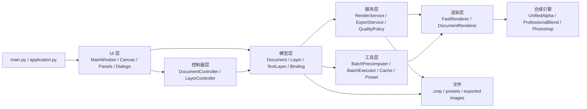
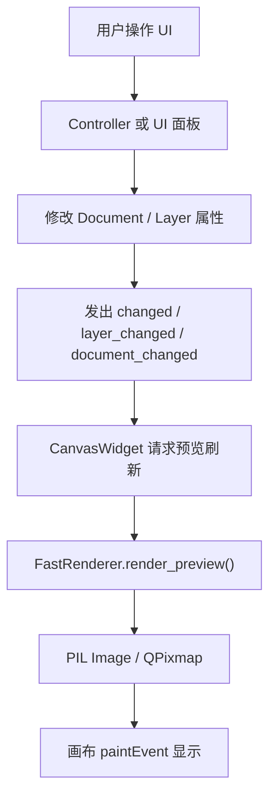
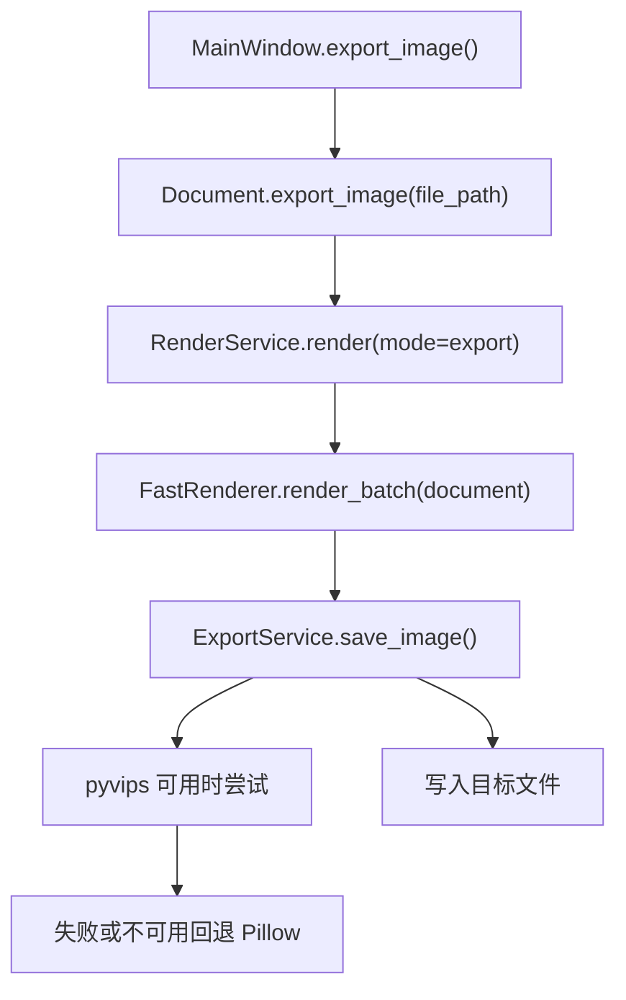
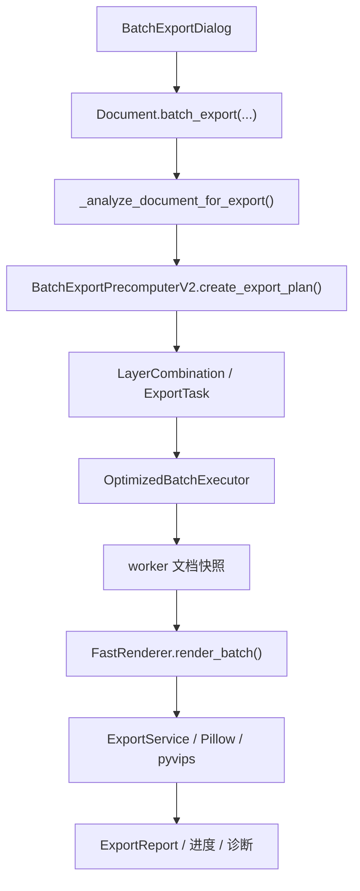
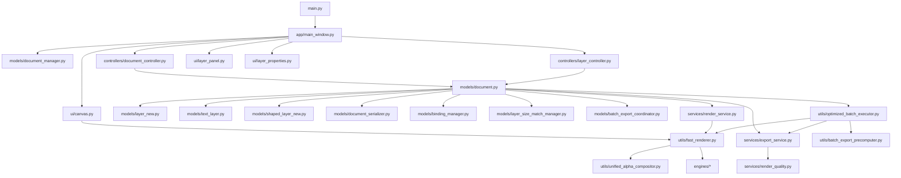

# 02. 整体架构

## 分层视图

## 主要职责边界

| 层 | 代表模块 | 职责 |
| --- | --- | --- |
| 入口 | `main.py` | 流重定向、日志、依赖检查、QApplication、主题、主窗口、退出清理 |
| UI | `app/main_window.py`、`app/ui/*` | 展示与交互、菜单工具栏、画布、面板、对话框、状态反馈 |
| 控制器 | `app/controllers/*` | 把菜单/按钮动作转为文档和图层操作 |
| 模型 | `app/models/*` | 文档状态、图层状态、绑定、历史、序列化、导出协调 |
| 服务 | `app/services/*` | 渲染/导出门面、质量策略、格式归一 |
| 渲染 | `app/utils/fast_renderer.py`、`app/models/document_renderer.py` | 图层合成、缓存、预览、批量导出渲染 |
| 批导工具 | `batch_export_precomputer.py`、`optimized_batch_executor.py` | 预计算组合、生成任务、并发渲染保存、报告 |
| 资源与预设 | `preset_manager.py`、`resources/`、`presets` | 内置资源、用户预设、预设索引 |

## 主数据流

### 编辑与预览

### 单图导出

### 批量导出

## 关键依赖关系

## 状态同步与信号

`Document` 是状态中心。常用信号包括：

| 信号 | 作用 |
| --- | --- |
| `document_changed` | 文档内容或保存状态变化，驱动标题、保存状态、画布刷新 |
| `layer_changed` / `layers_changed` | 图层列表或图层内容变化 |
| `layer_updated(int)` | 单个图层更新 |
| `layer_selected(int)` | 单选图层变化 |
| `layers_selection_changed(list)` | 多选图层变化 |
| `history_changed` | 撤销/重做状态变化 |
| `export_progress_updated(int)` | 批量导出进度 |
| `file_exported(str)` | 单个导出文件完成 |
| `export_stage_updated(str)` | 批量导出阶段文案 |

UI 面板修改模型属性后通常需要：

1. 清理相关缓存。
2. 标记文档修改。
3. 保存历史快照。
4. 发出对应信号。
5. 请求画布或面板刷新。

## 重要架构原则

- `Document` 当前仍是中心化模型，许多新旧入口都经过它。
- 新功能优先复用 `DocumentSerializer`、`FastRenderer`、`ExportService`、`PresetManager` 等已有接口。
- 批量导出阶段应使用预计算结果驱动渲染，不应在执行阶段引入新的不可控随机。
- 渲染缓存必须区分预览模式和批量模式。
