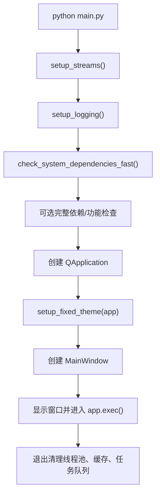

# 03. 运行与打包

## 开发运行

在项目根目录执行：

```powershell
pip install -r requirements.txt
python main.py
```

当前没有完整统一的测试套件。已有少量 unittest 回归测试，例如：

```powershell
python -m unittest tests.test_batch_export_dialog
```

涉及核心功能变更后，仍建议手动运行 `python main.py` 验证新建文档、添加图层、保存/加载、预览、导出和批量导出。

## `main.py` 启动流程



关键函数：

| 函数 | 说明 |
| --- | --- |
| `_safe_print(message)` | 控制台安全输出 |
| `check_system_dependencies_fast()` | 快速检查 Pillow、NumPy 等关键依赖 |
| `check_system_dependencies_full()` | 更完整的依赖和功能检查 |
| `setup_logging()` | 初始化日志系统 |
| `handle_exception(...)` | 全局异常处理 |
| `setup_fixed_theme(app)` | 应用 `CursorDarkTheme` |
| `main()` | 入口主流程 |

`app/application.py` 也是入口样式文件，但更像旧版/备用入口。维护时优先以 `main.py` 为准。

## 打包方式

推荐：

```powershell
python build.py
```

也可直接：

```powershell
pyinstaller 批图王.spec
```

`build.py` 会执行：

- 清理旧 `dist/` 和 `build/`。
- 检查 `app/resources`。
- 使用 `python -m PyInstaller`。
- 使用 `--windowed`、`--onefile`。
- 程序名设为 `批图王`。
- 图标使用 `app/resources/app_icon.ico`。
- 添加 `app/resources` 和根目录 `presets`。
- 如果存在 `version_info.txt`，传入版本信息。
- 添加隐藏导入：`PySide6`、`PIL`、`cv2`、`numpy`、`scipy`。

打包输出：

```text
dist/批图王.exe
```

## 生成目录

| 路径 | 说明 |
| --- | --- |
| `build/` | PyInstaller 中间产物 |
| `dist/` | 最终 exe 输出 |
| `__pycache__/` | Python 字节码缓存 |

这些目录都不应作为源码维护重点。

## 日志与用户数据

日志由 `app/utils/logger.py` 初始化，默认保存到用户配置目录下的 `批图王/logs`。预设和用户数据同样使用用户配置目录，详见 [07. 持久化与预设](07-persistence-and-presets.md)。

## 手动验证清单

涉及渲染、导出、图层属性、序列化或批量逻辑后，建议至少验证：

1. `python main.py` 能正常启动。
2. 新建画布并添加普通图片图层。
3. 添加文字图层，验证字体、换行、竖排、描边或渐变。
4. 添加异形图层，验证形状参数和旋转/缩放。
5. 保存为 `.cmp` 后重新打开。
6. 单图导出 PNG/JPG。
7. 批量导出多张，确认随机图片/文案没有异常重复。
8. 多标签页批量导出。
9. 打包后运行 `dist/批图王.exe`，确认资源和预设可用。
