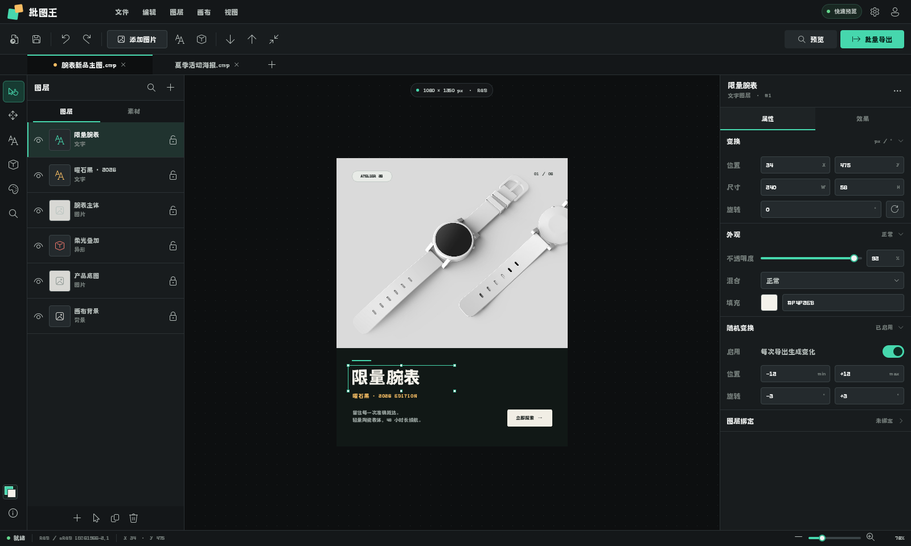

# 批图王 QML 工作台原型

这是一个独立的 Qt Quick/QML 视觉与交互原型，不会修改或启动现有 QWidget 主程序。



```powershell
python prototypes/qml_workbench/main.py
```

生成验证截图：

```powershell
python prototypes/qml_workbench/main.py --screenshot qml-workbench.png
```

可使用 `--width` 和 `--height` 指定截图尺寸。原型需要 PySide6，项目现有依赖已经包含。

画布产品摄影来自 [Unsplash](https://images.unsplash.com/photo-1523275335684-37898b6baf30)，素材仅用于本地界面原型展示。
